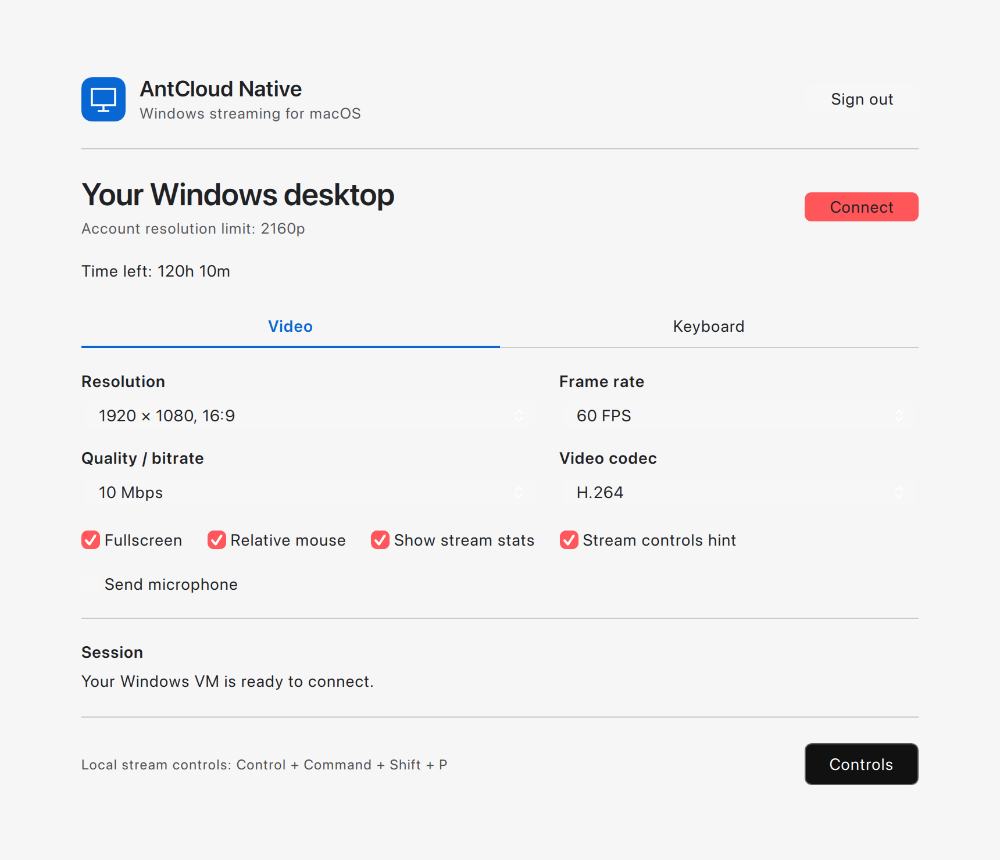
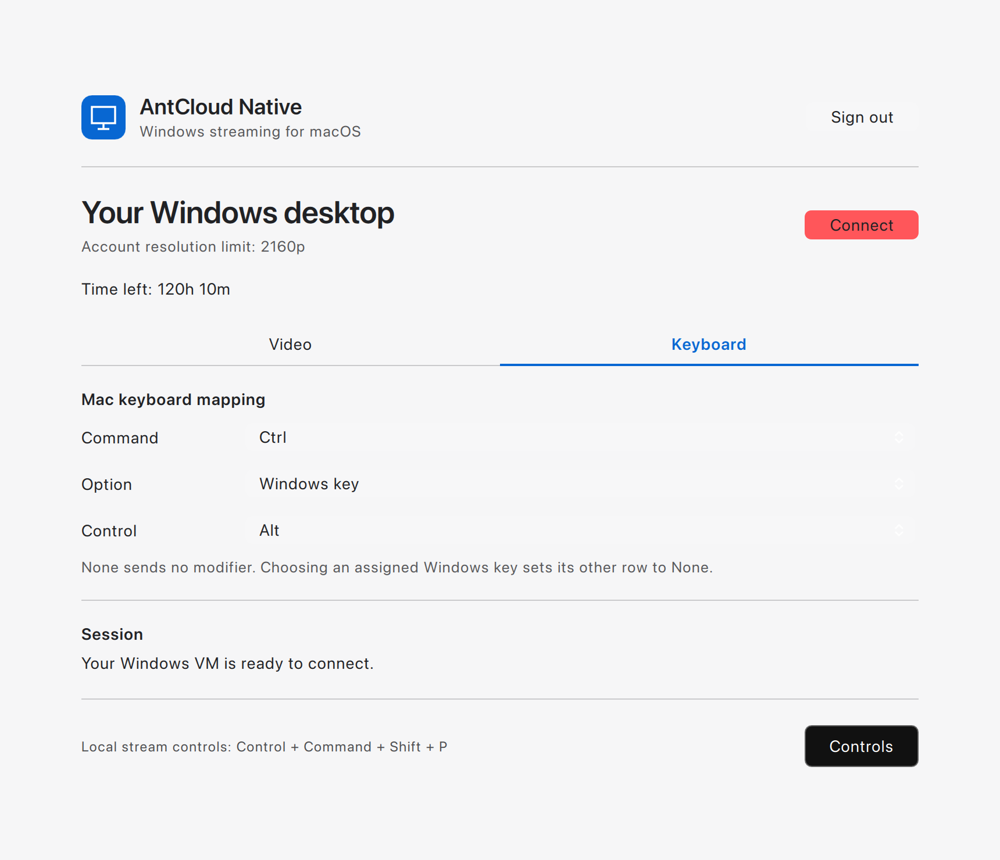

# AntCloud Native

AntCloud Native is an unofficial macOS client for AntCloud Windows VMs. It combines AntCloud account access and VM startup with Moonlight's native video, audio and input engine in one app.

Version **2.0.0** · [Repository](https://github.com/AshrafMd-1/antcloud-native-macos) · [Releases](https://github.com/AshrafMd-1/antcloud-native-macos/releases)

The app targets Apple Silicon and macOS 26 or newer. It is a personal project and is not affiliated with or endorsed by AntCloud or Moonlight.

## Features

- AntCloud sign-in, optional remembered login in macOS Keychain and supported token renewal.
- VM startup, native host discovery, pairing and Windows desktop launch.
- Fullscreen or windowed streaming with audio, keyboard, mouse and gamepad input.
- Twelve 16:9 and 16:10 resolution choices, 30/60/120 FPS, 2–50 Mbps bitrate and H.264/H.265/AV1 selection.
- Configurable Mac modifier keys and physical Mac shortcuts that remain available with every mapping.
- Stream controls for Resume, Stop stream and confirmed VM shutdown.
- RTT, video-frame loss, incoming FPS, video bitrate and provider-reported time remaining.
- Optional Mac microphone sending and Mac-to-Windows clipboard typing.
- Redacted, user-initiated diagnostic export.

## Interface

## Install and connect

Download `AntCloudNative-2.0.0-macos.zip` from the [releases page](https://github.com/AshrafMd-1/antcloud-native-macos/releases), extract it and move `AntCloudNative.app` to Applications. The distributed app is locally signed and is not notarized. See [build.md](build.md) for installation details and source-build instructions.

Open the app, sign in, choose the stream settings allowed by your account and select **Connect**. The app opens an AntCloud provider session, starts the VM when needed, discovers its native streaming host, pairs this Mac and launches the Windows desktop.

The app returns to its regular window after streaming ends. Wait until Connect becomes available before starting another session.

## Video settings

Fresh installations use **1920 × 1080, 16:9**, **60 FPS**, **10 Mbps** and **H.264**. Fullscreen, relative mouse, stream statistics and the controls hint start enabled. Microphone sending starts disabled.

Resolution choices:

- 1280 × 720, 16:9
- 1920 × 1080, 16:9
- 2560 × 1440, 16:9
- 3840 × 2160, 16:9
- 2560 × 1600, 16:10
- 2048 × 1280, 16:10
- 1920 × 1200, 16:10
- 1680 × 1050, 16:10
- 1440 × 900, 16:10
- 1280 × 800, 16:10
- 1024 × 640, 16:10
- 960 × 600, 16:10

The app checks the provider tier for each request, but an account allowance does not prove that the active VM exposes a matching Windows display mode or encoder. The native host receives the exact selected dimensions. If a high-resolution or 16:10 mode fails, use a mode supported by the current VM display driver.

The requested stream size and Windows' active desktop resolution can differ. For a sharper desktop, choose a matching supported mode in Windows Display settings.

Frame rate choices are **30, 60 and 120 FPS**. Bitrate choices are **2, 3, 4, 6, 8, 10, 12, 15, 20, 25, 30, 35, 40, 45 and 50 Mbps**. A higher requested bitrate needs enough network and host capacity; the measured video rate can remain below the selection.

Codec choices are **H.264**, **H.265 - if supported** and **AV1 - if supported**. H.265 and AV1 require compatible host encoding and Mac decoding. The Moonlight engine negotiates a usable format or reports a failure; selecting a codec does not add that capability to the VM. HDR is disabled.

Settings are saved as soon as the app accepts a change. They apply to the next connection. Changes made in a stream with the fullscreen, mouse-mode, statistics, controls-hint and microphone shortcuts are also saved, so the next stream starts with the resulting state.

## Keyboard mapping

The **Keyboard** tab maps three physical Mac modifier keys to Windows modifiers. The defaults are:

- **Command → Ctrl**
- **Option → Windows key**
- **Control → Alt**

Each row offers **None, Ctrl, Alt or Windows key**. Choosing a target that another row already uses changes the previous row to None. None sends no remote modifier. Mapping changes are saved immediately and the app snapshots the mapping when a stream starts.

With the defaults, Command+A/C/V/X/Z performs Windows select-all, copy, paste, cut and undo. Control+Tab sends Windows Alt+Tab when system-key capture is active. macOS continues to manage Fn/Globe.

## Local stream controls

Local shortcuts always use the physical **Control + Command + Shift** keys, independently of the modifier mapping. Hold those three keys, then press:

- **P** — open stream controls. Resume returns to the stream.
- **Q** — stop the stream and return to the app.
- **Z** — release or recapture input; releasing input opens stream controls.
- **X** — toggle fullscreen and save the new state.
- **S** — show or hide statistics and save the new state.
- **H** — show or hide the top-right controls hint and save the new state.
- **M** — switch between relative game mouse and absolute desktop mouse, and save the new state.
- **B** — toggle microphone sending and save the new state.
- **V** — type text from the Mac clipboard into the focused Windows field when the host supports clipboard typing.
- **C** — show or hide the cursor in desktop mouse mode.
- **D** — minimize the stream window.
- **L** — toggle pointer confinement in desktop mouse mode.
- **K** — toggle capture of macOS system keyboard shortcuts.
- **E** — stop streaming and exit the app.

The **Controls** button in the app shows the current mapping and the complete shortcut reference. The separate in-stream controls window provides Resume, Stop stream and Shutdown VM.

Clipboard typing sends text into the focused application. It does not synchronize both clipboards or transfer files.

## Audio and microphone

Windows audio plays through the normal Moonlight stream. **Send microphone** uses AntCloud's separate Android-compatible microphone channel: 44.1 kHz mono PCM16 little-endian audio sent to the validated VM address on UDP port 9002.

Microphone sending is off on a fresh installation. Once changed, the setting is retained. Enabling it before Connect does not start capture; capture begins only in a connected stream after macOS grants microphone access. Stop, Shutdown, a stream failure or app exit immediately ends capture and network sending while preserving the selected preference for the next connection. Permission denial or a local capture failure stops the current sending attempt and shows the error without ending video; the saved preference remains as selected.

Microphone audio on this channel is **unencrypted**. Enable it only on a trusted network. The app shows that notice only while the setting is enabled. In Windows, select the provider's recording endpoint in Sound or the application's input settings.

## Stop stream and shut down

**Stop stream** ends this Mac's streaming connection and returns to the app. It does not send an explicit VM shutdown request. Closing the stream or quitting has the same power-state behavior; AntCloud's own idle policy can still stop the VM.

**Shutdown VM** sends one provider shutdown request after confirmation. Save your Windows work first. The app reports that the request was sent; use the AntCloud dashboard to confirm the final power state.

## Statistics and time remaining

The stream overlay contains one line:

- **RTT** — control round-trip time to the streaming host, not total input latency.
- **Loss** — missing video frames, not raw network packet loss.
- **FPS** — incoming video frames, not the game's render rate.
- **Mbps** — recently received compressed video payload, excluding audio, headers and recovery traffic.
- **Time** — the latest validated provider-reported balance, formatted as hours and minutes, for example `120h 10m`.

The regular app window uses the same hours-and-minutes format. AntCloud supplies time through the account balance and active stream reports. The app refreshes account time after authentication, at stream boundaries and every 60 seconds. It does not invent a local billable countdown. `unavailable` means no valid provider value has arrived.

## Privacy and diagnostics

Passwords are transient and are not saved. When **Remember login** is enabled, access and refresh tokens are stored together in the device-local macOS Keychain. The app can rotate them through AntCloud's supported refresh endpoint. Signing out requests deletion of the saved login; an expired or rejected refresh token requires signing in again.

Stream preferences and native host identity use macOS per-user settings. Do not share those settings or Keychain contents as diagnostics.

The app keeps a bounded history of fixed, redacted status messages in memory. **Help → Export diagnostic report** writes that history only to a file you choose. Reports exclude passwords, tokens, pairing PINs, VM addresses, raw provider traffic and microphone audio.

## Source and license

[AGENTS.md](AGENTS.md) describes the architecture and maintenance contracts. [build.md](build.md) covers installation, building, testing and package checks. `source-provenance.json` records the exact Moonlight and dependency revisions, while `source-manifest.json` records release-source hashes.

AntCloud Native is based on Moonlight 6.2.0. The complete modified engine and pinned public dependency source are included under `src/`. Moonlight's GPL-3.0 license, copyright notices and dependency licenses remain in place; see [LICENSE](LICENSE), [src/LICENSE](src/LICENSE) and the notices distributed with the source. AntCloud-specific additions are GPL-3.0-or-later.
